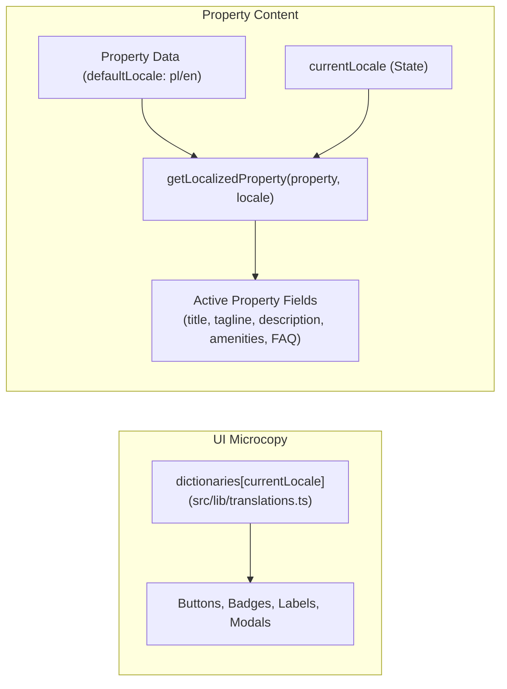
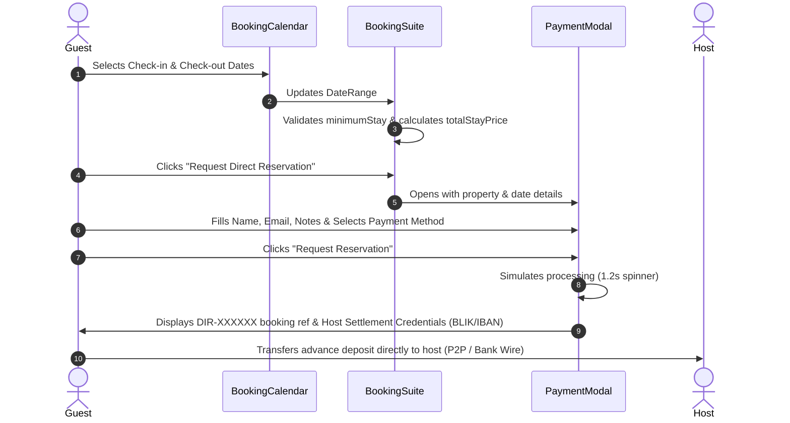

# Bookuj Architecture & Engineering Guide (`docs/ARCHITECTURE.md`)

> **Status:** Living Document  
> **Last Updated:** 2026-10-29  
> **Audience:** Developers and AI Pair Programmers (Gemini, Claude, GPT, etc.)

---

## 1. System Overview

Bookuj (`bookuj.pl`) is a specialized, white-label direct booking platform engineered for independent vacation rentals, alpine chalets, boutique retreats, and private lofts. It removes OTA marketplace commissions (0% fee to guest and host) while providing an Airbnb-grade, branded direct guest reservation portal.

### Core Architecture Pillars
1. **Dedicated Property Routing (`/[slug]`):** Each property has its own distinct canonical URL (e.g. `/zakopane-gorna-chata`).
2. **Supabase-First Data Layer:** Real property listings are stored in Supabase (`public.properties`), with graceful offline fallback to `src/data/default-properties.json`.
3. **Dynamic White-Label Theme Engine:** Visual styles (colors, fonts, layout preset) are declared per property and injected via CSS custom properties at runtime.
4. **Bilingual Foundation (Local + English):** Built from day one for international & domestic guests with instant language toggling (`pl` and `en`).
5. **Contactless Host Handoff:** The platform registers booking intent and hands off payment settlement directly to the host's credentials (BLIK, IBAN, Revolut/P2P, or pay on arrival).

---

## 2. Routing & Page Architecture

```mermaid
flowchart TD
    User([User Request]) --> URL{Path}
    URL -->|/| RootPage["src/app/page.tsx<br/>Informational: 'Nie określono obiektu'"]
    URL -->|/[slug]| SlugPage["src/app/[slug]/page.tsx<br/>Primary Property Page (ISR 60s)"]
    URL -->|/demo/[slug]| DemoPage["src/app/demo/[slug]/page.tsx<br/>Legacy Showcase Route"]
    
    SlugPage --> GetProps["getPropertyBySlug(slug)"]
    GetProps --> DB{"Supabase Configured?"}
    DB -->|Yes| Supabase["Supabase: public.properties"]
    DB -->|No / Error| FallbackJSON["Fallback: default-properties.json"]
    
    Supabase --> PropertyPageComp["PropertyPage.tsx<br/>(Client Orchestrator)"]
    FallbackJSON --> PropertyPageComp
```

### Route Breakdown
- `src/app/[slug]/page.tsx`:
  - Main dynamic property route using static site generation (`generateStaticParams`) and Incremental Static Regeneration (`export const revalidate = 60`).
  - Calls `getPropertyBySlug(slug)` ONLY (does not fetch `allProperties`).
  - Zero demo switcher contamination. 100% clean white-label host page.
  - Emits `notFound()` if the slug does not exist in Supabase or fallback JSON.
- `src/app/page.tsx`:
  - Root route. Renders an informational error page ("Nie określono obiektu") explaining that Bookuj runs dedicated per-host portals and invites testing via the Zakopane demo link.
- `src/app/demo/[slug]/page.tsx`:
  - Dedicated sales preview and concierge demonstration route.
  - Fetches `allProperties` and renders `PropertyPage` with the interactive `DemoPropertySwitcher` active.
- `src/app/demo/page.tsx` & `src/app/admin/page.tsx`:
  - Convenience entry points that automatically redirect to `/demo/zakopane-gorna-chata`.
- `src/app/api/revalidate/route.ts`:
  - On-demand ISR revalidation webhook (e.g., triggered on Supabase database updates).

---

## 3. Data Layer Architecture

### Hierarchy & Fallback Mechanism
All data fetching routes through `src/lib/propertyData.ts`:

1. Check `NEXT_PUBLIC_USE_LOCAL_DATA === 'true'`. If set, use local JSON immediately.
2. Check `isSupabaseConfigured` (`NEXT_PUBLIC_SUPABASE_URL` and `NEXT_PUBLIC_SUPABASE_ANON_KEY`).
3. Query Supabase table `public.properties` via `getSupabaseClient()` with `{ next: { revalidate: 60 } }`.
4. If query fails, returns 0 items, or encounters an exception, log a warning and fall back to `src/data/default-properties.json`.

```typescript
// Mapping Supabase row (snake_case) to domain Property (camelCase):
export function mapDatabaseRowToProperty(row: any): Property
```

---

## 4. Bilingual Localization Architecture

Bookuj maintains a clean separation between **UI Microcopy** and **Property Content Translations**:



1. **UI Dictionary (`dictionaries`):**
   - Implements `TranslationDictionary`.
   - Contains all labels, error messages, placeholders, and dynamic string interpolators (`nightCount(n)`, `advanceDeposit(percent, amount)`).
2. **Content Localizer (`getLocalizedProperty`):**
   - If `property.translations?.[currentLocale]` contains translated fields, it merges them over the default property fields.
   - If not translated, it gracefully retains the original listing text.

---

## 5. Theme Engine & Layout Presets

Visual branding is injected dynamically at the container level by `ThemeProvider`:

```tsx
<div
  className="min-h-screen transition-colors duration-300 font-sans"
  style={{
    '--color-primary': theme.primaryColor,
    '--color-accent': theme.accentColor,
    '--color-bg': theme.backgroundColor,
    backgroundColor: theme.backgroundColor,
  }}
>
```

### Layout Presets (`property.theme.layout`)

#### 1. `boutique` Layout (Default for Chalets, Cabins, Bespoke Stays)
Engineered for editorial, high-ticket vacation rentals (inspired by bespoke retreat websites):
- **Hero:** Full-bleed cinematic hero (`PropertyHero`) with Ken Burns effect and direct rate pill.
- **Section 1 — Host Backstory (`BoutiqueHostStory`):** Editorial card introducing the host, avatar, personal quote (`hostBio`), and direct hospitality promise.
- **Section 2 — Curated Comforts (`BoutiqueAmenities`):** High-resolution photography split with styled amenities.
- **Section 3 — Setting & Distances (`BoutiqueLocation`):** Approximate location map with travel distance indicators (ski slopes, trails, airports).
- **Section 4 — Searchable Host FAQ (`PropertyFAQ`):** Client-filtered accordion for house policies and amenities.
- **Section 5 — Reservation Suite:** High-contrast dark container (`bg-stone-900`) containing `BookingSuite`.

#### 2. `minimal` / Standard Layout (Urban Lofts, Modern Apartments)
Structured card-based grid architecture:
- Card split with `HostWelcomeCard` and `DirectBookingBenefitsCard`.
- `PropertyGallery` with photo grid.
- `AmenitiesList` with Lucide badges.
- `PropertyMap` with Leaflet tiles.
- Clean white container for `BookingSuite`.

---

## 6. Reservation & Checkout Flow



### Settlement Methods
- **BLIK P2P (`methodBlik`):** Polish instant phone transfer directly to host's `blikPhone`.
- **Direct Bank Wire / IBAN (`methodIban`):** Standard SEPA / Polish bank transfer directly to host's `iban`.
- **Instant P2P (`methodP2p`):** Revolut / PayPal direct handle.
- **Pay on Arrival (`methodArrival`):** Full payment at key handoff.

---

## 7. Component Hierarchy

```
PropertyPage (Client Orchestrator)
├── ThemeProvider (CSS variable injector)
│   └── MobileDeviceFrame (Simulated viewport frame)
│       ├── Header (Logo, contact buttons, language switcher)
│       │
│       ├── [IF boutique preset]
│       │   ├── PropertyHero
│       │   ├── BoutiqueHostStory
│       │   ├── BoutiqueAmenities
│       │   ├── BoutiqueLocation
│       │   ├── PropertyFAQ
│       │   └── BookingSuite (Dark container)
│       │       └── BookingCalendar
│       │
│       ├── [ELSE standard/minimal preset]
│       │   ├── PropertyHero
│       │   ├── HostWelcomeCard
│       │   ├── DirectBookingBenefitsCard
│       │   ├── PropertyGallery
│       │   ├── AmenitiesList
│       │   ├── PropertyMap
│       │   ├── PropertyFAQ
│       │   └── BookingSuite
│       │       └── BookingCalendar
│       │
│       ├── Footer
│       ├── MobileBottomCTA (Mobile sticky reservation bar)
│       ├── PaymentModal (Direct booking checkout modal)
│       ├── PropertyGalleryModal (Fullscreen image lightbox)
│       └── DemoPropertySwitcher (Dev preview switcher, hidden in prod)
```

---

## 8. Environment Variables

| Variable | Scope | Purpose | Example |
|---|---|---|---|
| `NEXT_PUBLIC_FEATURED_SLUG` | Client/Server | Slug of featured property for custom host deployments | `zakopane-gorna-chata` |
| `NEXT_PUBLIC_SHOW_DEMO_SWITCHER` | Client | Set to `'true'` to show the floating preview switcher | `true` |
| `NEXT_PUBLIC_SUPABASE_URL` | Client/Server | Supabase project URL | `https://xyz.supabase.co` |
| `NEXT_PUBLIC_SUPABASE_ANON_KEY` | Client/Server | Supabase anonymous public key | `eyJhbGciOi...` |
| `SUPABASE_SERVICE_ROLE_KEY` | Server only | Service role key for administrative seed scripts | `eyJhbGciOi...` |
| `NEXT_PUBLIC_USE_LOCAL_DATA` | Client/Server | Force local fallback JSON for offline development | `false` |

---

## 9. Developer & AI Pair Programming Rules

1. **Build Verification is Mandatory:**
   Always run the build check before finishing any task:
   ```bash
   export PATH="/Users/jan/.local/bin:$PATH" && npm run build
   ```
2. **Never Break the Dedicated Routing Contract:**
   The root route `/` must remain an informational error page. Direct listings must reside on `/[slug]`.
3. **Always Maintain Bilingual Support:**
   When adding new UI microcopy, always update both `pl` and `en` dictionaries in `src/lib/translations.ts`.
4. **Respect the Data Fallback:**
   Never assume Supabase is reachable. The offline fallback in `src/lib/propertyData.ts` and `src/data/default-properties.json` must remain functional.
5. **No Platform Watermarks:**
   Host-facing property pages must never include aggregator watermarks, marketplace search bars, or competitor links.

